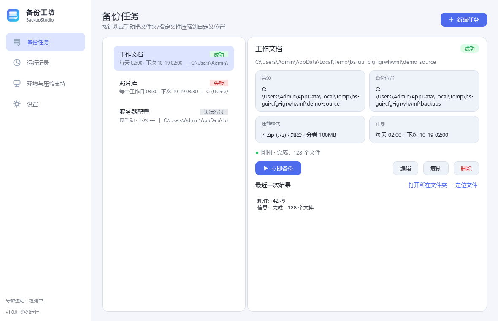
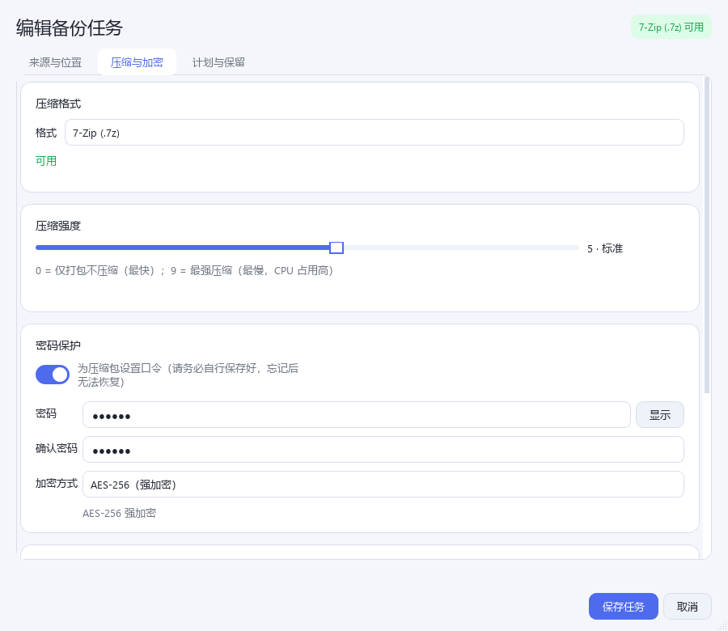
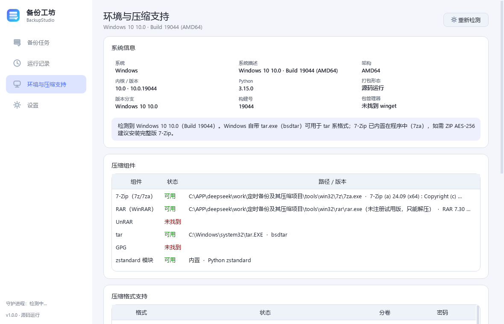
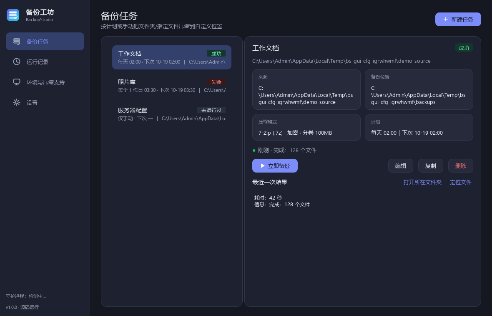

# 备份工坊 · BackupStudio

[](https://github.com/nan-tang-xi-xi-owo/BackupStudio/actions/workflows/build.yml)
[](https://github.com/nan-tang-xi-xi-owo/BackupStudio/releases)
[](LICENSE)


一个**跨平台**的定时文件夹备份工具：按你设定的时间（或随时手动）把**整个文件夹**或**文件夹中指定的文件**
压缩备份到你**自定义的位置**，支持 ZIP / 7z / RAR / tar 全系列格式、密码加密、分卷压缩；
界面美观，可最小化到**系统托盘**在后台运行。

> 分发形态：**Windows exe / 安装包**、**macOS dmg**、**Linux AppImage**、**Flatpak**，以及 Fedora / RHEL 系 **RPM**。



## 下载

到 [Releases](https://github.com/nan-tang-xi-xi-owo/BackupStudio/releases) 下载对应平台文件：

| 平台 | 文件 | 使用 |
| --- | --- | --- |
| Windows 10/11 x64 | `BackupStudio-1.1.0-windows-x64.zip` / `BackupStudio-Setup-1.1.0.exe` | 解压运行 `BackupStudio.exe`，或用安装包安装 |
| macOS（Apple Silicon / Intel） | `BackupStudio-1.1.0-arm64.dmg` / `BackupStudio-1.1.0-x64.dmg` | 拖入「应用程序」；未签名版首次需右键 → 打开 |
| Linux x86_64 | `BackupStudio-1.1.0-x86_64.AppImage` | `chmod +x` 后直接运行（需要 libfuse2） |
| Linux（通用） | `BackupStudio.flatpak` | `flatpak install --user BackupStudio.flatpak` |

---

## 功能一览

| 需求 | 实现 |
| --- | --- |
| 自定义时间 / 随时备份 | 仅手动、每隔 N 分钟/小时/天、每天、每周（可多选星期）、每月 N 日；托盘菜单一键「立即备份」 |
| 备份文件夹 or 文件夹里指定的文件 | 「整个文件夹」或「文件夹里指定的文件/子文件夹」两种模式，后者可逐个挑选 |
| 自定义备份位置 | 任意目录（含移动硬盘、网络盘），可配置文件名模板 `{name}_{datetime}` 等 |
| 全部压缩格式 | `zip` `7z` `rar` `tar` `tar.gz` `tar.bz2` `tar.xz` `tar.zst` |
| 分卷压缩 | 7z 原生分卷（`.001/.002`）、RAR 原生分卷（`part1.rar`）、通用字节切片（`.part01/.part02`，任何格式可用） |
| 压缩密码 | 7z/rar 默认 AES-256（7z 连文件名一起加密）；zip 支持 AES-256 与 ZipCrypto（后者会提示安全性较弱） |
| 检测操作系统 | Windows（版本/构建号）、macOS（版本）、Linux（**发行版 ID / 名称 / 版本 / 同族 / 桌面环境 / 包管理器**） |
| 检测缺什么、怎么装 | 「环境与压缩支持」页 + `backupstudio info/doctor`，列出缺的软件与对应发行版的安装命令 |
| 不支持的压缩 / 强制压缩 | 不可用项在下拉框里标出并说明原因；勾选「强制压缩」会用内置引擎降级生成（结果里提示实际格式） |
| 美观 GUI + 托盘 | PySide6 深/浅色主题、卡片式布局、进度条、状态徽章；托盘状态图标、气泡通知、免打扰时段 |
| 后台运行 | 系统托盘常驻 + 独立后台守护进程（关闭主窗口也会按计划执行），本地 IPC 通信 |
| 分发 | Windows exe / Inno Setup 安装包、macOS .app → .dmg、Linux AppImage、Flatpak、RPM |

还有：保留策略（按份数/天数/总量自动清理）、备份后校验、运行记录（可导出 CSV/JSON）、
开机自启（注册表 / LaunchAgent / XDG autostart）、命令行接口、无 GUI 的定时守护进程、
**随时可中断的备份**、**防路径穿越的安全解压**。

---

## 快速开始

### 1. 直接运行源码

```bash
python -m pip install -r requirements.txt
python -m backupstudio            # 打开图形界面
python -m backupstudio --help     # 命令行
```

要求 Python ≥ 3.10（开发环境为 3.12 + PySide6 6.12）。

### 2. 用打包好的程序

* **Windows**：`dist/BackupStudio/BackupStudio.exe`（onedir，内含 7za，开箱即用）。
  如需安装包：`pwsh packaging/make-windows-installer.ps1`（需 Inno Setup 6）。
* **macOS**：`python packaging/build.py` → `bash packaging/make-dmg.sh` → `dist/BackupStudio-1.1.0-<arch>.dmg`
* **Linux AppImage**：`python packaging/build.py` → `bash packaging/make-appimage.sh` → `dist/BackupStudio-1.1.0-x86_64.AppImage`
* **Flatpak**：`flatpak-builder --user --install --force-clean build-dir packaging/io.github.backupstudio.BackupStudio.yml`
* **RPM**（Fedora/RHEL/openEuler）：`bash packaging/make-rpm.sh`

> PyInstaller 不能交叉编译：Windows/macOS/Linux 必须在各自系统上各打一次。
> 仓库自带 `.github/workflows/build.yml`，推 tag 即可在 CI 里产出全部四种格式并自动创建 Release。

---

## 界面

| 备份任务 | 压缩与加密 |
| --- | --- |
|  |  |

| 环境与压缩支持（Linux 会显示发行版与缺失软件） | 深色主题 |
| --- | --- |
|  |  |

* `Ctrl+N` 新建任务，`Ctrl+B` 立即备份当前任务，`F5` 刷新，`Ctrl+,` 设置。
* 关闭窗口默认最小化到托盘；托盘右键可「立即运行任务」「打开配置目录」「退出」。
* 托盘图标右下角的小圆点表示状态：蓝=空闲，黄=正在备份，绿=上次成功，红=上次失败。

---

## 压缩格式与依赖

每种格式都有「首选引擎」和「后备引擎」，程序会自动选择，并在界面上告诉你缺失了什么。

| 格式 | 首选引擎 | 后备（强制压缩） | 分卷 | 密码 |
| --- | --- | --- | --- | --- |
| `zip` | 7-Zip（随包 7za） | 内置 `zipfile`（真 ZIP） | 通用切片 | AES-256（需完整版 `7z.exe`）/ ZipCrypto |
| `7z` | 7-Zip | 内置 `py7zr`（原生 7z 格式） | 通用切片 | AES-256（含文件名加密） |
| `rar` | WinRAR / RAR | 用内置引擎写「7z 内容 + .rar 扩展名」或「ZIP 内容 + .rar 扩展名」（结果中会注明） | 通用切片 | AES-256 |
| `tar` `tar.gz` `tar.bz2` `tar.xz` `tar.zst` | Python 标准库（流式） / 系统 tar | — | 通用切片 | GPG（装了 gpg 时可用） |

**需要额外安装什么？**

* **7-Zip**（免费）：Windows 已随包携带 `7za`；想要 ZIP 的 AES-256 或图形界面，装完整版即可
  （`winget install 7zip.7zip` / `brew install p7zip` / `apt install p7zip-full`）。
* **RAR**（**专有软件**，本程序不附带）：<https://www.rarlab.com/download.htm>。
  未注册版只能解压不能打包，程序会直接告诉你这一点，而不是给你一个坏文件。
* **tar.zst**：`pip install zstandard` 或安装系统 `zstd`。

> 说明：如果外部压缩程序**能装但写不出文件**（例如目标目录被安全软件拦截），
> 勾选「强制压缩」或在失败弹窗里点「用内置引擎重试」，程序会用内置引擎生成**同一格式**（zip/7z）的文件，
> 结果里会注明引擎与格式。

---

## 命令行

```bash
# 查看系统 + 每种格式是否可用 + 缺失软件
backupstudio info
backupstudio info --json
backupstudio doctor
backupstudio selftest          # 自检：目录权限、日志、压缩引擎、界面组件

# 管理任务
backupstudio task add --name "工作文档" --source D:\work --dest E:\backups \
    --format 7z --password 'S3cret!' --volume-size 500 --schedule weekly \
    --days 1,3,5 --time 23:30
backupstudio task list
backupstudio task show <id>
backupstudio task enable <id> on
backupstudio task rm <id>

# 立即执行
backupstudio run <id|name>
backupstudio run --all

# 后台守护进程（无界面也能按计划备份）
backupstudio daemon            # 后台启动
backupstudio daemon --status
backupstudio daemon --stop
backupstudio daemon --foreground --verbose   # 前台调试

# 解压（带路径穿越防护）
backupstudio extract E:\backups\x_20261018.7z --to D:\restore --password 'S3cret!'
```

---

## 数据存放位置

| 平台 | 配置 |
| --- | --- |
| Windows | `%APPDATA%\BackupStudio\`（`tasks.json`、`history.jsonl`、`logs\`） |
| macOS | `~/Library/Application Support/BackupStudio/` |
| Linux | `${XDG_CONFIG_HOME:-~/.config}/backupstudio/` |

环境变量 `BACKUPSTUDIO_CONFIG_DIR` 可覆盖（便于测试或便携使用）。
若配置目录不可写，程序会自动回退到 `%LOCALAPPDATA%\BackupStudio` 或临时目录，并在日志中说明。

**关于密码**：备份密码以明文保存在 `tasks.json` 中（文件权限 0600），这样才能无人值守地加密备份。
请自行做好该目录的访问控制；分享配置时用「导出任务」并选择**不含密码**。

---

## 项目结构

```
backupstudio/
  app.py            入口：GUI / 托盘 / CLI / 守护进程分发 + 启动防护
  daemon.py         后台守护进程（调度 + ZeroMQ 本地 IPC）
  engine.py         一次备份的完整流程：扫描→压缩→校验→保留策略→记录
  archives.py       压缩后端：zipfile / tarfile / 7-Zip / RAR / py7zr，分卷与取消
  py7zr_backend.py  纯 Python 写入后端（7z 原生 / ZIP 用标准库）
  extract.py        安全解压（阻止 zip-slip / tar-slip）
  capabilities.py   按本机实际能力计算「格式 × 分卷 × 密码」矩阵与缺失软件
  platform_info.py  系统 / Linux 发行版 / 包管理器 / 桌面环境探测
  tools.py          7-Zip、RAR、tar 的查找与版本探测
  schedule.py       调度纯函数（下次执行、是否到期）
  store.py          配置仓库（原子写入、损坏恢复、导入导出）
  config.py         任务 / 计划 / 保留 / 通知 / 设置 / 运行记录 数据模型
  notify.py         托盘气泡 + macOS osascript + Linux notify-send + 免打扰
  autostart.py      开机自启（注册表 / LaunchAgent / XDG autostart / systemd）
  staging.py        同盘暂存目录
  gui/              PySide6 界面（主题、卡片、任务页、编辑对话框、运行记录、环境页、设置页、托盘）
  assets/tray/      运行时图标（PNG，随包分发）
packaging/          打包脚本与资源（图标、desktop、metainfo、Flatpak manifest、spec、dmg/AppImage 脚本）
tests/              pytest（调度、配置、扫描、各格式端到端、保留策略、取消、解压安全）
dev/                开发期测试脚本（CLI/GUI/托盘/端到端自测）
```

---

## 开发与测试

```bash
python -m pytest tests -q                       # 250 个用例
python dev/tester_cli.py                        # CLI 端到端
python dev/tester_round2.py                     # 格式/边界/并发/守护进程
python dev/tester_gui.py                        # GUI 全流程（离屏）
python dev/tester_gui2.py                       # 取消/托盘/关闭到托盘
python dev/tester_security.py                   # 安全（zip-slip、损坏配置、错误密码）
python dev/tray_check.py                        # 打包版托盘图标验证
python packaging/build.py                       # 打 exe
python packaging/make_icons.py                  # 重新生成图标（ico/icns/png）
```

测试覆盖：7 种格式端到端、中文/emoji 文件名、排除规则、保留策略、分卷拼接与密码校验、
写入与压缩阶段取消、并发执行、守护进程启停、损坏配置恢复、畸形导入、zip-slip/tar-slip 防护、
GUI 全流程（新建/运行/编辑/复制/删除/主题/设置）、托盘图标存在性。

---

## 常见问题

**双击后没有任何反应（没有窗口、也没有托盘图标）？**

1. 双击后若弹出「程序启动失败」窗口，点「Show Details」把内容发出来；
2. 运行 `BackupStudio.exe selftest`，它会检查配置目录、运行目录、日志目录是否可写、压缩引擎是否可用；
3. 查看日志（按顺序找第一个存在的）：
   - `%APPDATA%\BackupStudio\logs\app.log`
   - `%APPDATA%\BackupStudio\logs\startup.log`
   - `BackupStudio.exe` 同目录下的 `logs\startup.log`
   - `%TEMP%\BackupStudio-logs\startup.log`
4. 若日志提示「配置目录不可用」，程序已自动改用 `%LOCALAPPDATA%\BackupStudio` 或 `%TEMP%`，
   可用环境变量 `BACKUPSTUDIO_CONFIG_DIR` 指定一个确定可写的目录再启动。

**窗口能打开，但托盘里没有图标？**

- Windows 11 默认会**隐藏新出现的托盘图标**：点任务栏右下角的 `^`（显示隐藏的图标），
  找到「备份工坊 / BackupStudio」拖到可见区域即可；也可以在托盘右键「任务栏设置 → 其他系统托盘图标」里打开它。
- 若图标完全不存在：程序会在日志（`logs\app.log`）里记录托盘状态；从旧版升级请用新包整体覆盖 `BackupStudio` 目录
  （不要只替换 exe，旧包会缺 `_internal\backupstudio\assets\tray` 图标资源）。
- 程序每 30 秒自查一次托盘；Windows 资源管理器重启导致图标丢失时会自动补回。

**为什么 Linux 上有的格式显示不可用？** 界面「环境与压缩支持」页会写明原因
（缺 7-Zip / 缺 tar / 缺 zstd / 缺 gpg），并按你的发行版给出安装命令，例如
`sudo apt install p7zip-full`、`sudo dnf install p7zip`、`sudo pacman -S p7zip`。

**关闭窗口后备份还会跑吗？** 会——守护进程在后台按计划执行；也可以在「设置」里关闭「关闭窗口时最小化到托盘」。
守护进程状态在「设置 → 后台守护进程」里可见。

**分卷包怎么还原？** 7z：只选 `.001` 用 7-Zip 解压；RAR：选 `part1.rar`；
通用切片：`cat x.tar.gz.part* > x.tar.gz`（Windows：`copy /b x.tar.gz.part* x.tar.gz`）后再解压；
也可以直接用 `backupstudio extract`。

**为什么提示「外部压缩程序无法写入」？** 极少数受限环境（沙箱、低完整性、被重定向的临时目录、安全软件实时防护）
会阻止 7z 在目标目录创建文件。按提示用内置引擎重试，或换一个目标目录。

---

## 发布流程（维护者）

```bash
# 1) 更新版本号：backupstudio/__init__.py 与 pyproject.toml
# 2) 更新 CHANGELOG.md 与 docs/RELEASE_NOTES_<版本>.md
# 3) 打标签推送，GitHub Actions 会自动构建四个平台并创建 Release
git tag v1.1.0 && git push origin v1.1.0
```

CI 会产出：Windows 便携 zip + Inno Setup 安装包、macOS arm64/x64 的 dmg、
Linux AppImage、Flatpak bundle，并生成 `SHA256SUMS.txt` 附在 Release 页。

---

## 致谢

- [Qt for Python (PySide6)](https://doc.qt.io/qtforpython/) —— 界面框架
- [7-Zip](https://www.7-zip.org/) —— 压缩引擎
- [py7zr](https://github.com/miurahr/py7zr) —— 纯 Python 的 7z 备选引擎
- [python-zstandard](https://github.com/indygreg/python-zstandard) / [pyzstd](https://github.com/animalize/pyzstd) —— zstd 支持

## 许可

MIT，见 [LICENSE](LICENSE)。第三方组件许可见 [packaging/THIRD-PARTY-NOTICES.txt](packaging/THIRD-PARTY-NOTICES.txt)。
